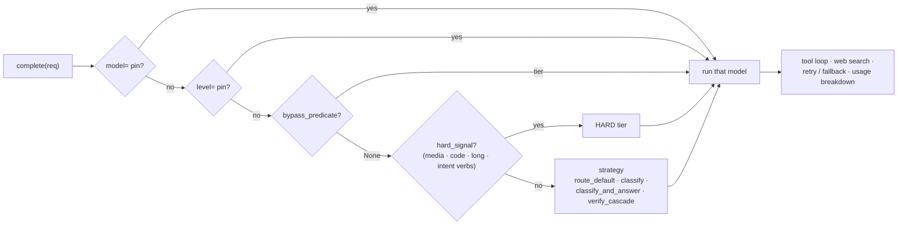

<p align="center">
  
</p>

# maslul

[](https://pypi.org/project/maslul/)
[](https://pypi.org/project/maslul/)
[](https://github.com/iliatankelevich/maslul/actions/workflows/ci.yml)
[](LICENSE)

**Smart LLM router — one call, the right model.**

Async and fully typed, across Anthropic, Gemini, xAI, and OpenAI — routing each request to the
right model tier by difficulty. Stop hardcoding model choices and stop re-writing the tool-use /
structured-output / web-search / retry plumbing for every provider.

`maslul` (Hebrew *מסלול*, "route / lane") is a small library that does exactly two things:
**routing** (pick a model tier per request, or pin one) and **provider normalization** (one
`Request`/`Response` shape for every SDK). No server, no CLI, no heavy ML deps — providers
live behind extras, and the core is stdlib-only.

```python
import asyncio
from maslul import Router, Request, Message

router = Router.from_toml("maslul.toml")           # tiers + classifier + providers, from config

async def main() -> None:
    resp = await router.complete(Request(messages=[Message(role="user", content="Hello!")]))
    print(resp.text, "·", resp.level_used, "·", resp.usage.output_tokens, "tokens")

asyncio.run(main())
```

## Install

```bash
pip install "maslul[anthropic,gemini,xai,openai]"     # or just the providers you use
```

Each provider's SDK lives behind an extra, so `import maslul` pulls in **none** of them — you
only install what you route to. `maslul[anthropic]` → `anthropic`; `maslul[gemini]` →
`google-genai`; `maslul[xai]` → `xai-sdk`; `maslul[openai]` → `openai`. The optional
[Jev hooks](#jev-hooks-optional) are `maslul[jev]` → `httpx`.

## How it compares

maslul is **a library, not a gateway** — you embed the routing brain in your app, you don't run a
proxy in front of it.

| | **maslul** | **RouteLLM** | **LiteLLM** |
|---|---|---|---|
| Shape | async library you embed (no server) | research framework / trained router | unified SDK **+ proxy server** |
| Routing | difficulty **tiers** + swappable strategies (`route_default` / `classify` / `classify_and_answer` / `verify_cascade`) + injectable `bypass` / `classifier` / `verifier` hooks | a **trained** strong-vs-weak router | manual config / fallback lists, load-balancing |
| Providers | Anthropic · Gemini · xAI · OpenAI, **normalized** | model-agnostic (you wire models) | 100+ providers |
| Tools / structured / vision | one normalized loop for all | — | per-provider |
| **Web search** | **one flag, every provider** → `Response.sources` | — | per-provider |
| Caching | exact **+ semantic** (in-process) | — | exact + semantic (proxy) |
| Typing / footprint | fully typed, `py.typed`; stdlib core, SDKs behind extras | research code | larger; server to operate |

**Choose maslul when** you want a typed async library you embed — difficulty routing with your own
strategy + hooks, and one `Request`/`Response` over several providers (tools, structured output,
vision, **web search**, retries, cost cache) — *without* standing up a gateway. Reach for **LiteLLM**
when you want a provider proxy across 100+ models, or **RouteLLM** when you specifically want a
trained router.

## The routing brain



## Routing

Difficulty is **not** readable from surface features — a short prompt can be very hard, a long
paste trivial — so maslul never applies a `short ⇒ simple` rule. You choose how each request is
routed, in this precedence order:

```python
from maslul import Level

await router.complete(req, model="anthropic:claude-opus-4-8")  # 0. pin an exact model
await router.complete(req, level=Level.HARD)                   # 1. pin a difficulty tier
await router.complete(req)                                     # 2-4. let the router decide
```

When you don't pin, the **routing brain** runs: a deterministic **bypass** (your fast-path, e.g.
greetings → SIMPLE) → a **hard-signal** detector (intent verbs, code, attachments, long context →
HARD, *up-only*) → the configured **strategy** for the ambiguous middle:

| Strategy | Cost for the middle | What it does |
|---|---|---|
| `ROUTE_DEFAULT` | 0 calls | Default-to-capable (`default_level`). Best for low volume. |
| `CLASSIFY` | 1 classify + 1 answer | A cheap dedicated classifier model labels the level (cached + budget-guarded), then dispatch. |
| `CLASSIFY_AND_ANSWER` | 1 call | The classifier model answers directly, or emits an escalation sentinel to bump to a stronger tier. |
| `VERIFY_CASCADE` | 1 cheap + verify | Answer cheap, run your verifier, escalate if it rejects — catches silent under-escalation. |

Every step is a hook you can supply — `bypass_predicate`, `hard_signal` (replaces the built-in
detector), `classifier` and `verifier`:

```python
def my_bypass(req):          # deterministic fast-path: a tier, or None to keep routing
    return Level.SIMPLE if req.messages[-1].content.lower() in {"hi", "thanks"} else None

def my_classifier(req):      # your own difficulty call (sync or async); None defers to the strategy
    return Level.SIMPLE if is_trivial(req) else None

def my_verifier(req, resp):  # VERIFY_CASCADE: True keeps the cheap answer, False escalates
    return "I don't know" not in resp.text

router = Router.from_toml(
    "maslul.toml", bypass_predicate=my_bypass, classifier=my_classifier, verifier=my_verifier
)
```

## One shape for every capability

The same `Request`/`Response` works across every provider:

```python
from maslul import Request, Message, ToolDef, ToolCall, MediaPart

# Tools — the router runs a provider-agnostic tool-use loop
async def get_weather(call: ToolCall) -> str:
    return f"18°C in {call.input['city']}"

req = Request(
    messages=[Message(role="user", content="Weather in Paris?")],
    tools=[ToolDef(name="get_weather", description="Current weather for a city.",
                   input_schema={"type": "object", "properties": {"city": {"type": "string"}},
                                 "required": ["city"]})],
    tool_executor=get_weather,
)

# Structured output — response_format → resp.structured (parsed)
req = Request(messages=[Message(role="user", content="Extract name + age")],
              response_format={"type": "object", "properties": {"name": {"type": "string"},
                                                                "age": {"type": "integer"}}})

# Vision — images / PDFs
req = Request(messages=[Message(role="user", content="What's in this image?")],
              media=[MediaPart(mime_type="image/png", data=png_bytes)])

# Web search — one flag, grounded on ANY provider (Anthropic web_search / Gemini Google Search /
# xAI Agent Tools / OpenAI search models); citations land in resp.sources whichever model answers.
req = Request(messages=[Message(role="user", content="Latest news on X?")], web_search=True)
```

## Resilience & observability

```python
def on_usage(resp):                         # per-model token breakdown for monitoring
    for rec in resp.usage_records:
        metrics.incr(f"{rec.provider}:{rec.model}", rec.usage.output_tokens)

router = Router.from_toml("maslul.toml", on_complete=on_usage)
```

Transient errors (`RateLimited`, `Timeout`) retry with exponential backoff; on persistent failure
the request **falls back to the next-higher tier** — which may be a different provider, giving you
cross-provider failover for free. A tool loop **resumes** across those attempts: a model call that
fails after tools ran continues from their results, so no tool runs twice for one request, and the
usage of every call that succeeded is counted. `AuthError` fails fast. Hooks: `on_route` (the
`RoutingDecision`), `on_complete` (the final `Response` with `usage_records`), `on_error` (each
failed attempt).

Build a router with `missing_provider="degrade"` and any tier whose provider isn't configured
(e.g. an xAI tier with no `XAI_API_KEY`) **falls back to the nearest available tier** instead of
erroring — so one config runs across deploys that have different keys.

## Cost cache

A `[maslul.cache]` config returns a prior `Response` instead of calling a model — `exact` (identical
request) or `semantic` (nearest request above a cosine threshold, using an embedder you inject, since
maslul ships no embeddings). A hit comes back with `cached=True` and **zeroed usage**, so monitoring
sees the saving. Tool-using requests are never cached.

```toml
[maslul.cache]
mode = "semantic"          # off | exact | semantic
max_entries = 1000
ttl_seconds = 86400
similarity_threshold = 0.95
```
```python
router = Router.from_toml("maslul.toml", embed=my_async_embed)   # embed only needed for semantic
```

## Prompt caching

A different lever from the cost cache above, and they compose: the cost cache **doesn't call the
model**; prompt caching **calls it, but pays ~0.1×** for the part of the prompt it has already seen.
Ask a second question about a 100k-token PDF and you re-send the whole PDF — Anthropic will serve it
from cache for a tenth of the price, but only if you tell it what's stable.

You declare **what is stable**, never a mechanism. Anthropic gets explicit `cache_control`
breakpoints; Gemini, OpenAI and xAI cache a matching *prefix* automatically, so what they need is
**layout** — and that's the one lever that works on all four:

```python
from maslul import ContextCache, MediaPart, Message, Request

req = Request(
    messages=[Message(role="user", content="What does clause 4 say?")],
    system=[PERSONA],
    media=[MediaPart(mime_type="application/pdf", data=pdf_bytes)],
    context_cache=ContextCache(media=True, ttl_seconds=3600, key=f"doc-{doc_id}"),
)
resp = await router.complete(req, model="anthropic:claude-sonnet-4-6")   # pin: caches are model-scoped
print(resp.usage.cache_read_input_tokens)   # the only proof that any of it worked
```

The biggest win costs nothing at runtime. Media used to be attached to the **last** user message on
every provider, *after* that message's text — the most volatile slot in the prompt. So the document
sat behind the question, every new question produced a different prefix, and a cache could never
reach it. `media=True` moves the document to the **first** user message **and ahead of the question**,
into the prefix every provider keys its cache off. Measured live on a 79k-token PDF: a follow-up
question went **$0.237 → $0.024**.

| | Anthropic | Gemini | OpenAI | xAI |
|---|---|---|---|---|
| Mechanism | explicit `cache_control` breakpoints (≤ 4, budgeted for you) | implicit prefix | implicit prefix | implicit prefix |
| `system` / `media` / `history` | ✅ (`system` also covers **tools**) | layout only | layout only | layout only |
| `ttl_seconds` | 5 min, or 1 h at `>= 3600` | — | `24h` retention at `>= 3600` | — |
| `key` | — | — | `prompt_cache_key` | — (no-op: `xai_sdk` has no per-request headers) |

Two things to know. **Caches are model-scoped and the router picks the model** — a cache written on
`simple` is cold on `hard`, so pair `media=True` with a pinned model; maslul emits exactly what you
ask for and won't silently drop it. And **`Usage`'s input fields are disjoint** — `input_tokens` is
what you paid full price for; the prompt's true size is `input_tokens + cache_read + cache_creation`.

## Configuration

A TOML file (or a plain `dict` — `Router(config={...})`):

```toml
[maslul]
strategy = "route_default"        # route_default | classify | classify_and_answer | verify_cascade
default_level = "hard"            # default-to-capable for the ambiguous middle
min_tokens_to_classify = 40       # CLASSIFY budget guard
request_timeout = 60              # per-call seconds (optional)
max_retries = 2
fallback = true                   # escalate to a higher tier on persistent failure

[maslul.tiers.simple]
provider = "gemini"
model = "gemini-3.5-flash-lite"
[maslul.tiers.medium]
model = "anthropic:claude-haiku-4-5"   # or the provider:model shorthand
[maslul.tiers.hard]
model = "anthropic:claude-sonnet-4-6"

[maslul.classifier]               # required for the classify strategies
model = "anthropic:claude-haiku-4-5"

[maslul.providers.anthropic]
api_key_env = "ANTHROPIC_API_KEY"      # secrets by env-var name, never inlined
[maslul.providers.gemini]
vertex_project = "my-gcp-project"      # Vertex AI + Application Default Credentials (no key)
vertex_location = "global"
[maslul.providers.xai]
api_key_env = "XAI_API_KEY"
```

Pointing a capability at a different model or provider is a one-line config change — no code
deploy. Providers can also be injected directly (`Router(config, providers={...})`) for tests or
custom wiring.

## Model parameters

Write parameters once, in generic form, and each provider translates them into its own SDK call:

```python
Request(messages=[...], temperature=0.2, max_tokens=1024, reasoning="high")
```

The same keys work on a tier (and on `[maslul.classifier]`) as that model's defaults. A request that
sets the same key wins:

```toml
[maslul.tiers.simple]
model = "gemini:gemini-3.8-flash"
temperature = 0.0
seed = 7

[maslul.tiers.hard]
model = "anthropic:claude-sonnet-4-6"
max_tokens = 8192
reasoning = "high"
```

| Generic | Anthropic | OpenAI | Gemini | xAI |
|---|---|---|---|---|
| `max_tokens` | `max_tokens` | `max_completion_tokens` | `max_output_tokens` | `max_tokens` |
| `temperature` · `top_p` | same name | same name | same name | same name |
| `top_k` | `top_k` | — | `top_k` | — |
| `seed` | — | `seed` | `seed` | `seed` |
| `stop` (request only) | `stop_sequences` | `stop` | `stop_sequences` | `stop` |
| `reasoning` = `low` · `medium` · `high` | adaptive thinking + `output_config.effort`; a `budget_tokens` on models before Claude 4.6 (Haiku 4.5) | `reasoning_effort` | `thinking_config.thinking_level` | `reasoning_effort` |
| `tool_choice` = `auto` · `required` · `none` · a tool name (request only) | `tool_choice` | `tool_choice` | `tool_config` | `tool_choice` |

A **—** means the provider has no equivalent, and the value is ignored. Turning `reasoning` on also
drops the sampling parameters that reasoning models refuse: `temperature`, `top_p` and `top_k` on
Anthropic, `temperature`, `top_p` and `stop` on OpenAI, `stop` on xAI. A forced `tool_choice`
applies to the first turn of the tool loop only, so the model can still answer.

**Raw options, when the generic set isn't enough.** A tier's `options` table takes raw SDK keywords
for that model, under each SDK's own names (Anthropic `messages.create()`, OpenAI
`chat.completions.create()`, Gemini `GenerateContentConfig`, xAI `chat.create()`):

```toml
[maslul.tiers.medium]
model = "openai:gpt-5.5"
options = { reasoning_effort = "xhigh", service_tier = "flex" }
```

On a request, `provider_options` does the same. Scope it by provider, and each provider reads only
its own entry, so one request can carry raw options for every tier it might be routed to:

```python
Request(messages=[...], provider_options={
    "anthropic": {"metadata": {"user_id": "u-42"}},
    "openai": {"safety_identifier": "u-42"},
})
```

Unscoped keys (`provider_options={"thinking": ...}`) still work on Anthropic and OpenAI, as before,
and are ignored by Gemini and xAI.

**Precedence**, lowest to highest: tier generic keys, then request generic fields, then tier
`options`, then request `provider_options`. Raw always wins, which is how you set what the generic
form can't express: `xhigh` or `max` reasoning, turning thinking off, or a Gemini 2.5
`thinking_budget`.

⚠️ maslul translates parameters, but it keeps no per-model capability list. A value the model
refuses is the API's error to raise. The two to know about: the newest Claude models (Opus 4.7 and
later, Sonnet 5 and later) reject `temperature`, `top_p` and `top_k`, and Opus 5.5, Sonnet 5.5 and
Fable 5.1 reject a forced `tool_choice`. A request-level value goes to whichever model the router picks, so
set model-specific parameters on the tier.

## Providers

| Provider | SDK (extra) | Auth |
|---|---|---|
| `anthropic` | `anthropic` | `ANTHROPIC_API_KEY` |
| `gemini` | `google-genai` | Vertex AI + ADC (`vertex_project`), or a Gemini Developer API key |
| `xai` | `xai-sdk` | `XAI_API_KEY` |
| `openai` | `openai` | `OPENAI_API_KEY` |

Provider names follow the API vendor, so xAI's Grok models are `xai:grok-4.3`. The pre-0.6 name
`grok` (provider key, `maslul[grok]` extra, `maslul.providers.grok`) still works as a deprecated
alias and emits a `DeprecationWarning`.

## Jev hooks (optional)

[TypeSafe Jev](https://docs.typesafe.ai) is not an LLM provider — it returns typed, calibrated
decisions (a choice between levels, a yes/no probability), not text — so it plugs into the
*hook* contract instead of `Provider`. `maslul[jev]` (`httpx`) adds `JevClassifier` (a
`classifier` hook) and `JevVerifier` (a `verifier` hook, for `VERIFY_CASCADE`):

```python
from maslul.jev import JevClassifier, JevVerifier

router = Router.from_toml(
    "maslul.toml",
    classifier=JevClassifier(min_confidence=0.7),   # api_key from TYPESAFE_API_KEY
    verifier=JevVerifier(min_yes=0.7, on_error="accept"),
)
```

Or build both from a `[maslul.jev]` config table with `maslul.jev.hooks_from_config(config)` —
`Router` has no generic hook-plugin registry, so this is a plain factory: it reads the table and
returns the hooks for you to pass into `Router(classifier=..., verifier=...)`; `Router` itself
never looks at `[maslul.jev]`, so an explicitly-injected hook always wins. Every call is caught and
resolved as `None` (classifier) / `on_error`'s policy (verifier, default `"accept"`) — an outage of
this optional hook never breaks routing.

**The level descriptions matter more than the language.** With abstract descriptions ("moderate
reasoning", "deep reasoning"), a week-by-week moving plan, a savings split and an insurance
comparison all came back `medium`, in English and Hebrew alike. With concrete examples per level
(the defaults now), the same requests come back `hard` at 0.97 to 0.99 confidence. Override them
for your workload in `[maslul.jev.criteria]` (`simple`/`medium`/`hard`), or with `level_criteria=`.

English is Jev's primary training language, and TypeSafe says other languages are "handled but not
equally well". So calibrate `min_confidence` and `min_yes` on your own traffic:
`await classifier.decide(req)` and `await verifier.judge(req, resp)` return the raw decision (level
or `p_yes`, probabilities, confidence, model, usage) without applying the gate.

## License

[MIT](LICENSE) © Ilia Tankelevich
